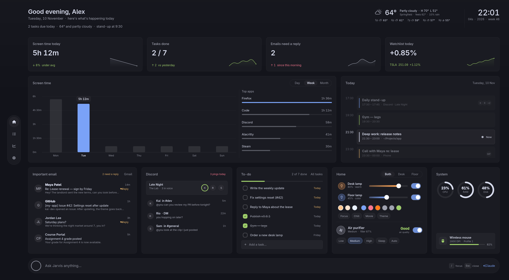
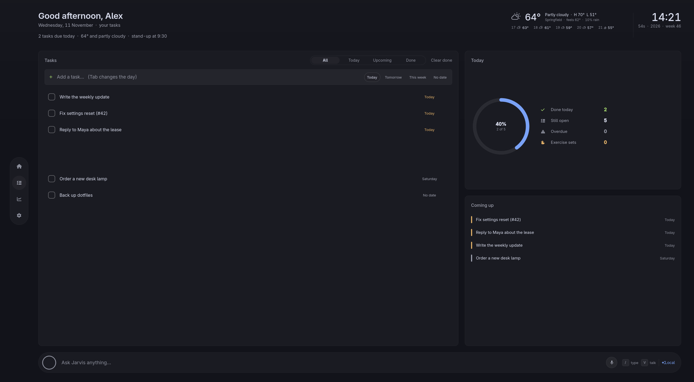
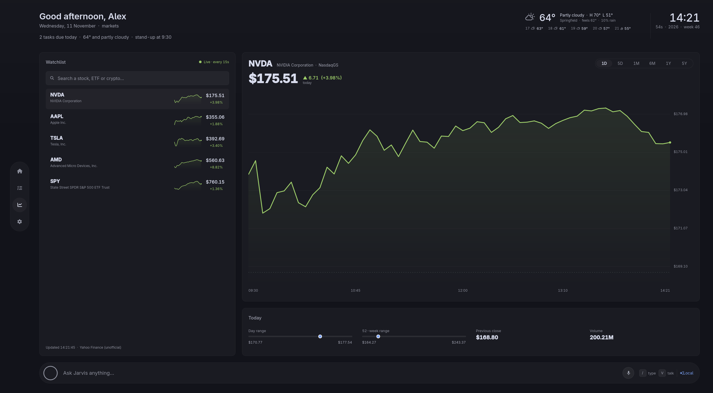
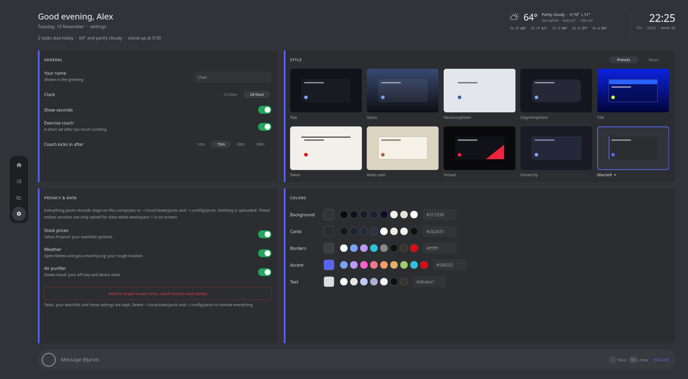
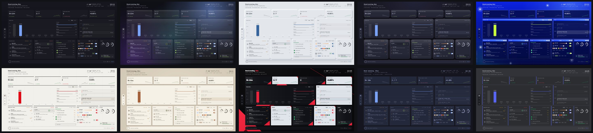
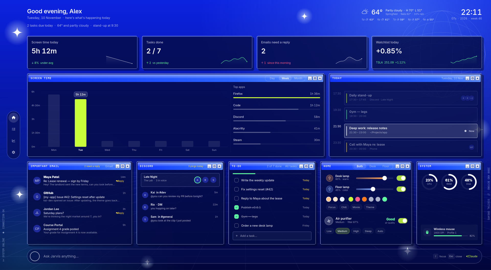
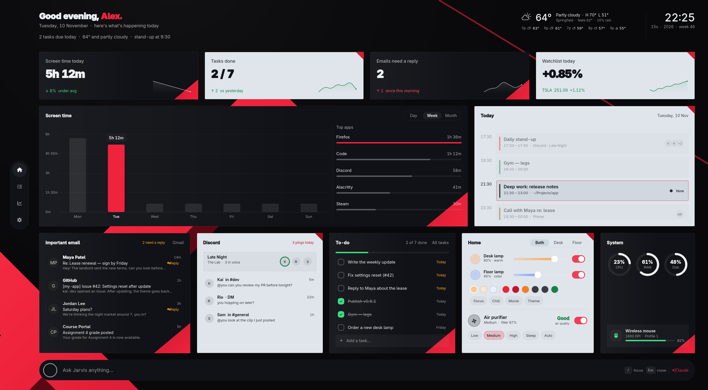

# Jarvis

A home screen for [Omarchy](https://omarchy.org) that lives on workspace 1:
screen time, tasks, live stocks, weather, Govee lamps and air purifier,
Discord, and an exercise coach that nudges you off doomscrolling. It runs
inside the Omarchy shell as the `ynnad.jarvis` plugin.



| Tasks | Stocks | Settings |
|---|---|---|
|  |  |  |

Ten styles, switchable in Settings, with your own colors on top: flat, glass,
neumorphism, claymorphism, Y2K, Swiss, wabi-sabi, Ynnad (obsidian, ice grey
and racing red), **Omarchy** (matches your desktop: your Omarchy theme's
colors, font, corners and wallpaper, and follows theme changes) and
**Discord** (Discord's dark theme, embeds and all).







Screenshots use made-up demo data.

**Not finished yet**, and labeled as such on screen: the email card ("Gmail
isn't linked yet") and the chat bar, which answers from your local data with a
note that Claude isn't connected.

## Install

```bash
omarchy plugin add https://github.com/Ynnad242/omarchy-dashboard --enable
```

Jarvis opens as a normal window. To keep it on workspace 1 and add a shortcut,
put these in `~/.config/hypr/looknfeel.lua` and `~/.config/hypr/bindings.lua`
(any free key works; Super+Shift+J is free on a stock Omarchy):

```lua
-- looknfeel.lua: Jarvis always opens on workspace 1, without stealing focus.
o.window({ class = "^org.quickshell$", title = "^Jarvis$" }, { workspace = "1 silent" })

-- bindings.lua: jump to Jarvis (and reopen it if it was closed).
o.bind("SUPER + SHIFT + J", "Jarvis", [[omarchy-shell shell summon ynnad.jarvis '{}']])
```

Needs Omarchy with the Lua Hyprland config and `python3` (standard library
only). It uses the Adwaita Sans font when installed, and falls back otherwise.

## Optional setup

Everything below is optional; cards without their source say what's missing.

**Govee lamps** (local network, no account)
1. In the Govee Home app, turn on *LAN Control* for each light.
2. Allow the lights' replies through Omarchy's firewall:
   ```bash
   sudo ufw allow from 192.168.1.0/24 to any port 4002 proto udp comment 'Govee LAN'
   ```
   (Use your own network's range if it isn't `192.168.1.x`.)
3. Keep the lamp's own switch on; turn it on and off from Jarvis.

**Govee air purifier** (Govee cloud): get a free API key in the Govee Home app
(Profile → Settings → Apply for API Key) and save it, readable only by you:
```bash
mkdir -p ~/.config/jarvis && printf '{"apiKey": "YOUR-KEY"}\n' > ~/.config/jarvis/govee.json && chmod 600 ~/.config/jarvis/govee.json
```

**Discord**: pings and DMs come from Discord's desktop notifications (Discord →
User Settings → Notifications → Enable Desktop Notifications). The live voice
strip needs the [ynnad.discord-stream](https://github.com/Ynnad242/omarchy-discord-overlay)
overlay, which shares its voice state with Jarvis; that overlay also hides its
floating widgets while Jarvis is on screen.

**Exercise coach**: on by default. After 15 minutes on YouTube, TikTok,
Instagram, Reddit, X, Facebook, Twitch or Snapchat you get one notification and
a short upper-body set to do; nothing is ever locked. Change or switch it off
in Settings, or edit the site and app lists in `~/.config/jarvis/coach.json`.

## Use

| Key | Does |
|---|---|
| Super+1, or your shortcut | Go to Jarvis |
| 1 2 3 4 | Home, Tasks, Stocks, Settings |
| Esc | Back to Home |
| / | Ask Jarvis |
| T | Add a task |
| S | Search stocks |
| Tab, Space, arrows | Move between and change controls in Settings |

Settings has the style, colors, your name, the clock, the exercise coach, and a
switch for every online service. Under Style, **Presets** are the ten built-in
looks and **Yours** holds themes you save: pick a preset, change any colors,
then "Save current" (or "Save as theme" on the Colors card) to switch back to it
any time. Saved themes stay on your computer.

## Privacy

Everything Jarvis records stays on this computer. Nothing is uploaded, there
is no account, no analytics and no tracking.

**Stored locally**

| File | What |
|---|---|
| `~/.local/state/jarvis/screentime.json` | Seconds per app (or known site, like YouTube) per day, last 60 days |
| `~/.local/state/jarvis/coach.json` | The exercise coach's meter, current challenge, sets done today |
| `~/.local/state/jarvis/todos.json` | Your tasks |
| `~/.local/state/jarvis/weather.json`, `home.json` | Caches of the last weather and lamp/purifier state |
| `~/.config/jarvis/settings.json`, `look.json`, `coach.json`, `stocks.json` | Your settings, style, saved themes and watchlist |
| `~/.config/jarvis/govee.json` | Your Govee API key (readable only by you) |

Screen time records the focused app's name. For browsers it records only which
known site the tab is on (YouTube, GitHub, ...), not page titles; Steam games
are recorded by their window title, which is the game's name.

**Read locally, never stored or sent**

- Omarchy's notification history, filtered to Discord, for pings and DMs.
- Your Discord voice channel, shared by the `ynnad.discord-stream` overlay
  through `$XDG_RUNTIME_DIR/discord-voice.json` (memory only).
- CPU, memory and disk usage from `/proc` and `df`.

**Online services** (only while workspace 1 is on screen; each can be switched
off in Settings)

| Service | Sent | Why |
|---|---|---|
| Yahoo Finance (`query1.finance.yahoo.com`) | Your watchlist symbols and searches | Prices and charts. Unofficial public endpoints, no key. |
| Open-Meteo (`api.open-meteo.com`) | Rough coordinates | Weather. |
| geo.omarchy.org | Your IP address (as with any request) | Your rough location, if none is saved in Omarchy's weather settings. Same source as Omarchy's weather panel. |
| Govee cloud (`openapi.api.govee.com`) | Your API key, device IDs, commands | The air purifier. Lamps use the local network only. |

**Delete your data**: Settings → Privacy & data → hold "Erase" removes screen
time, coach history and caches. To remove everything, delete
`~/.local/state/jarvis` and `~/.config/jarvis`.

## Accessibility

With each style's default colors, text meets WCAG AA contrast (4.5:1) on cards; controls in
Settings work from the keyboard, and controls carry names for screen readers.
Most motion follows Omarchy's animation setting (`omarchy toggle animations`).

## Licenses

Jarvis's code is MIT licensed (see `LICENSE`). It bundles no fonts or images;
it uses fonts already on the system: Adwaita Sans (SIL OFL 1.1), JetBrainsMono
Nerd Font (SIL OFL 1.1, icons MIT/OFL), Liberation Sans (SIL OFL 1.1), C059 (URW base35,
AGPL-3.0 with font exception). Data from Yahoo Finance, Open-Meteo and Govee
is subject to their own terms; Jarvis is for personal use. Stock data comes
from Yahoo Finance's public, unofficial endpoints, which can change or stop
working without notice.

Jarvis is not affiliated with or endorsed by Discord, Govee, Yahoo, Open-Meteo
or Omarchy.

## Development

- `JARVIS_DEMO=1` in the shell's environment shows made-up data everywhere and
  saves nothing (used for the screenshots).
- `JARVIS_STYLE=glass` (etc.) forces a style.
- `omarchy-shell shell call ynnad.jarvis setPage 2` opens a page;
  `omarchy-shell shell call ynnad.jarvis testCoach ''` fires an exercise
  challenge, and `testCoachClear` clears it.
